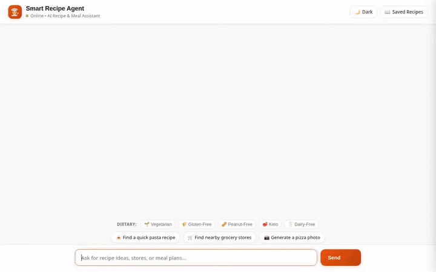

# 🍳 Smart Recipe Agent

An intelligent, conversational culinary assistant built on Google's **Agent Development Kit (ADK)**. Smart Recipe Agent helps home cooks discover recipes, check pantry substitutions, generate AI dish previews, scale ingredient nutrition, and locate nearby grocery stores while strictly remembering dietary restrictions and allergies across user sessions.



---

## 🌟 Key Features & Implementation

This agent is built using Google ADK and integrates with Google Cloud services:

* **🧠 Vertex AI Memory Bank Integration** (`VertexAiMemoryBankService` & `PreloadMemoryTool`)
  * Persists user dietary restrictions, allergies (e.g. peanuts, gluten, dairy), and favorite cuisines across sessions.
  * Automatically preloads user memory facts at the start of every turn and updates Memory Bank upon turn completion.

* **🗄️ Google Cloud Firestore Database** (`database.py`)
  * Performs Firestore queries for local recipe search by cuisine, prep time, and ingredients.
  * Stores user-submitted custom recipes into Firestore.
  * Checks pantry substitutions and allergy-safe ingredient alternatives.

* **🎨 A2UI (Agent-to-User Interface) Visual Cards** (`a2ui_utils.py` & `A2uiSchemaManager`)
  * Formats responses into structured A2UI v0.8 visual cards (`Card`, `Column`, `Row`, `Text`, `Image`).
  * Emits raw JSON dataparts rendered dynamically by compatible frontends.

* **🖼️ AI Image Generation & Google Cloud Storage** (`image_tools.py`)
  * Generates high-quality visual food previews of recipes using Gemini image models (`gemini-3.1-flash-lite-image` / `imagen-3.0-generate-002`).
  * Uploads generated images directly to a Google Cloud Storage bucket (`gs://smart-recipe-assets-...`) and outputs public HTTPS URLs.

* **🗺️ Google Maps & Places Integration** (`maps_tools.py`)
  * Geocodes addresses into latitude/longitude coordinates (`geocode_address`).
  * Finds nearby supermarkets, specialty grocery stores, and food markets (`search_nearby_places`).

* **🌐 External Recipe API Integration** (`external_tools.py`)
  * Queries external recipe search endpoints (`search_online_recipes`) to find global meal instructions and dish ideas.

* **🔢 Sandboxed Python Code Executor** (`executor.py`)
  * Runs python code in an ADK sandbox for exact nutrition math, unit conversions, and ingredient scaling calculations.

---

## 🏗️ Architecture Overview

```
smart-recipe-agent/
├── app/                        # Agent backend codebase (ADK)
│   ├── agent.py                # Root agent definition, Memory Bank & callback hooks
│   ├── a2ui_utils.py           # A2UI schema manager & visual card formatter
│   ├── database.py             # Firestore queries & pantry substitution logic
│   ├── external_tools.py       # Online recipe search integration
│   ├── image_tools.py          # Gemini image generation & Cloud Storage upload
│   ├── maps_tools.py           # Google Maps & Places geocoding/search
│   └── executor.py             # Sandboxed Python code executor for calculations
├── frontend/                   # Web frontend proxy & responsive chat UI
│   ├── main.py                 # FastAPI proxy server (A2A protocol)
│   ├── requirements.txt        # Frontend python dependencies
│   └── static/index.html       # HTML5/CSS3 UI with dark mode, dietary tags & lightbox
├── agents-cli-manifest.yaml    # Agents CLI manifest configuration
└── demo.gif                    # Animated demo screen recording
```

---

## 🛠️ Local Setup & Execution Instructions

### Prerequisites
* Python 3.10+
* Google Cloud SDK (`gcloud` CLI authenticated to your GCP project)
* Activated GCP Services: Vertex AI, Firestore, Cloud Storage, Maps Places API

### 1. Environment Setup

Clone the repository and install the backend dependencies:

```bash
cd smart-recipe-agent
python3 -m venv .venv
source .venv/bin/activate
pip install -r requirements.txt
```

### 2. Running the Local Frontend Proxy

To run the web proxy locally on port `8080`:

```bash
cd frontend
pip install -r requirements.txt

# Set environment variables for your reasoning engine and agent directory
export AGENT_ENGINE_RESOURCE_NAME="projects/<PROJECT_ID>/locations/<LOCATION>/reasoningEngines/<ENGINE_ID>"
export AGENT_DIRECTORY="app"

python main.py
```

Open a browser and navigate to port `8080` on your server host to interact with the Smart Recipe Agent interface.

---

## ☁️ Deployment

### Deploying the Frontend to Cloud Run

To deploy the frontend proxy service to Google Cloud Run:

```bash
gcloud run deploy smart-recipe-frontend \
  --source ./frontend \
  --region us-west1 \
  --set-env-vars AGENT_ENGINE_RESOURCE_NAME="projects/<PROJECT_ID>/locations/<LOCATION>/reasoningEngines/<ENGINE_ID>",AGENT_DIRECTORY="app" \
  --allow-unauthenticated
```

Ensure the Cloud Run compute service account has been granted the `roles/aiplatform.user` IAM role to reach the Reasoning Engine instance.
